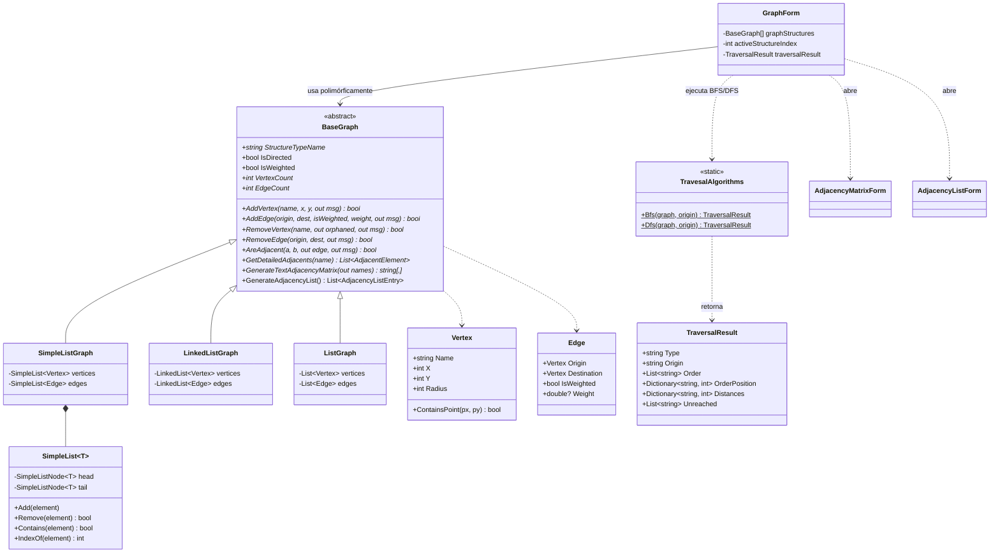
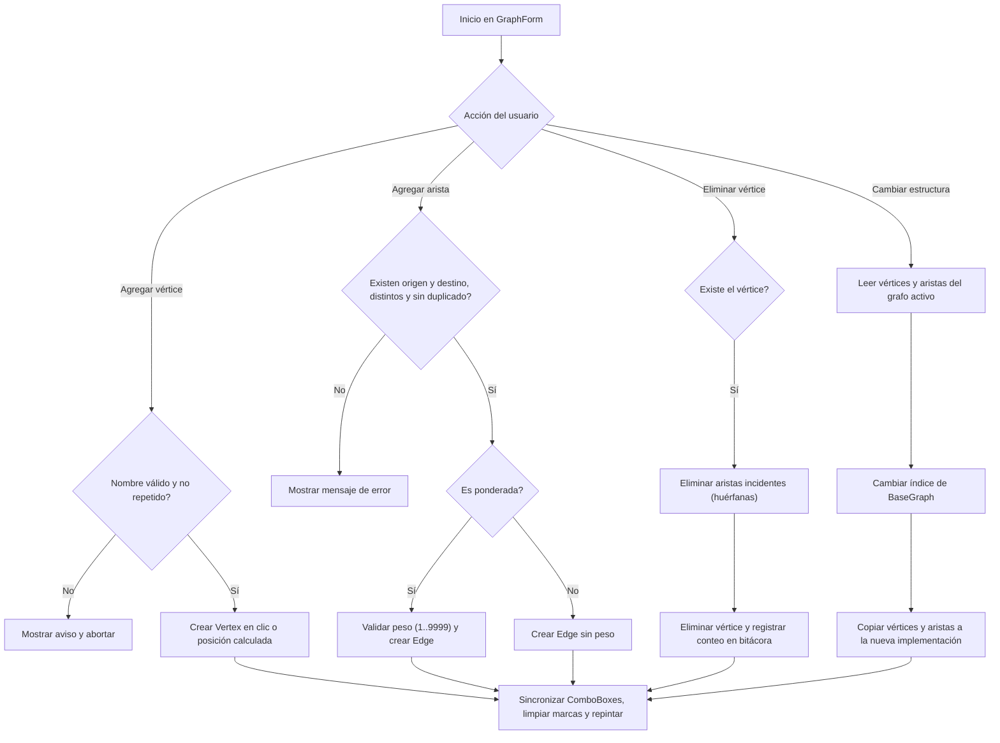
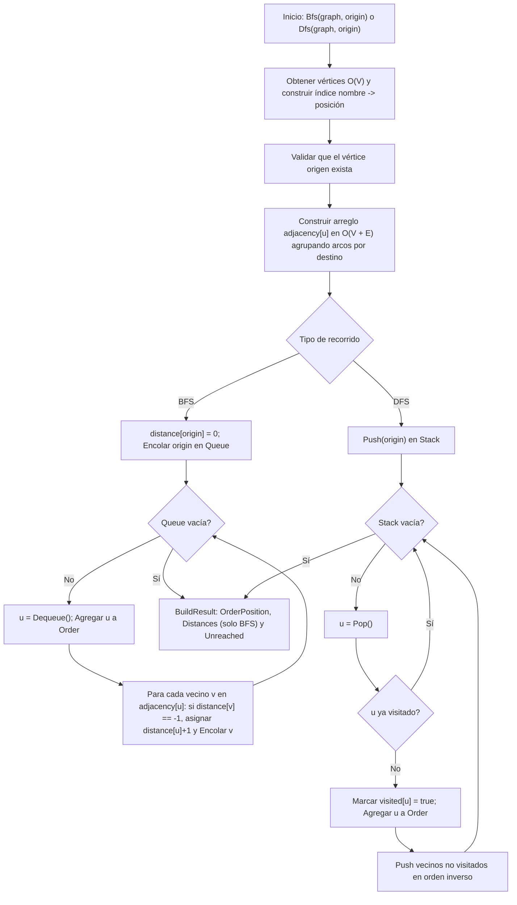
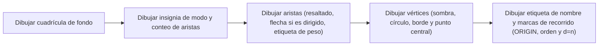

# Ruta de mapas – Grafos

Aplicación de escritorio en **C# / Windows Forms** para crear, editar y analizar grafos de forma visual. El usuario coloca vértices sobre un lienzo interactivo, los conecta con aristas (dirigidas o no dirigidas, ponderadas o no ponderadas), inspecciona la estructura mediante matriz y lista de adyacencia, y ejecuta recorridos **BFS** y **DFS** con visualización de orden de visita y distancias.

---

## Características principales

- **Edición visual del grafo**: clic en el lienzo para ubicar un vértice, arrastre de vértices con el ratón (con límites de margen en el lienzo) y doble clic en un espacio vacío para enfocar el campo de nombre.
- **Vértices y aristas**: alta y baja de vértices (la baja elimina automáticamente las aristas conectadas o huérfanas) y de aristas.
- **Modos de grafo**: dirigido (`A -> B`) o no dirigido (`A <-> B`), y ponderado (peso numérico de `1` a `9999`) o no ponderado.
- **Tres implementaciones intercambiables** de la misma clase base (`BaseGraph`), seleccionables en tiempo de ejecución conservando el grafo actual:
  - Lista simple propia (`SimpleListGraph`, respaldada por `SimpleList<T>`).
  - `LinkedList<T>` de .NET (`LinkedListGraph`).
  - `List<T>` de .NET (`ListGraph`).
- **Verificación de adyacencia y vecinos**: comprobación directa entre dos vértices con resaltado visual en el lienzo y consulta de vecinos (o sucesores salientes en grafos dirigidos).
- **Vistas de representación**: ventanas independientes para la **Matriz de Adyacencia** y la **Lista de Adyacencia**, con navegación directa entre ambas.
- **Recorridos BFS y DFS**: ejecución en tiempo **O(V + E)** mediante cola (BFS, con distancia mínima en aristas `d=n`) y pila iterativa (DFS), mostrando insignias de orden de visita sobre el lienzo.
- **Bitácora de operaciones**: registro cronológico con marca de tiempo y categoría (`LogCategories`).

---

## Requisitos previos y tecnologías

| Elemento | Detalle |
|---|---|
| Sistema operativo | Windows (la aplicación usa Windows Forms y fuentes como *Segoe UI*). |
| Framework | **.NET 10** (`net10.0-windows` según `Ruta de mapas/Ruta de mapas.csproj`). |
| SDK | .NET 10 SDK, o Visual Studio con soporte para .NET 10. |
| Formato de solución | `Ruta de mapas.slnx` (formato XML de solución; requiere herramientas recientes que lo soporten). |
| Lenguaje | C# con `<Nullable>enable</Nullable>` e `<ImplicitUsings>enable</ImplicitUsings>`. |
| Dependencias externas | Ninguna: el proyecto solo referencia el SDK de .NET y Windows Forms. No utiliza paquetes NuGet externos. |

---

## Instalación y ejecución

1. **Instalar el SDK de .NET 10** desde el sitio oficial de Microsoft, o instalar Visual Studio con la carga de trabajo *Desarrollo de escritorio .NET*.
2. **Clonar el repositorio**:
   ```bash
   git clone https://github.com/BrayanRomo-bit/Ruta-de-mapas-Grafos-.git
   cd Ruta-de-mapas-Grafos-
   ```
3. **Restaurar y compilar** (o abrir `Ruta de mapas.slnx` en Visual Studio):
   ```bash
   dotnet restore "Ruta de mapas.slnx"
   dotnet build "Ruta de mapas.slnx" -c Debug
   ```
4. **Ejecutar**:
   ```bash
   dotnet run --project "Ruta de mapas/Ruta de mapas.csproj"
   ```
   También puede ejecutarse directamente con `F5` desde Visual Studio.

---

## Arquitectura del proyecto

El proyecto separa la interfaz gráfica (`Forms` y `Controls`), la configuración (`Configuration`), los modelos de dominio (`Models`), las estructuras propias (`Structures`), las implementaciones polimórficas del grafo (`Graphs`) y los algoritmos de recorrido (`TraversalAlgorithms`).



---

## Diagramas de flujo

### 1. Flujo principal de operaciones sobre el grafo



### 2. Flujo de los algoritmos de recorrido (BFS y DFS)

Ambos algoritmos en `TraversalAlgorithms.cs` preparan la lista de adyacencia en **O(V + E)** agrupando arcos por destino para mantener el orden de creación sin necesidad de ordenar (`Sort`), y luego ejecutan el recorrido:



### 3. Flujo de renderizado del lienzo (`PanelGraphCanvas_Paint`)



---

## Reglas de negocio y comportamiento

- **Identificadores únicos**: los nombres de vértices se comparan sin distinción entre mayúsculas y minúsculas (`StringComparison.OrdinalIgnoreCase`) y se recortan espacios laterales (`Trim()`).
- **Sin auto-bucles**: no se permite conectar un vértice consigo mismo (`origin.Equals(destination)`).
- **Duplicidad de aristas**:
  - En modo **dirigido**, `A -> B` y `B -> A` son aristas distintas y ambas pueden coexistir.
  - En modo **no dirigido**, `A <-> B` y `B <-> A` representan la misma conexión y no se permite duplicarla.
- **Rango de pesos**: las aristas ponderadas admiten valores numéricos enteros de `1` a `9999` desde el control `numEdgeWeight`.
- **Cambio de modo dirigido / no dirigido**: al alternar el modo, se actualiza la bandera `IsDirected` de las tres estructuras y se limpian las marcas de recorrido previas, pero las aristas ya existentes conservan su par `(Origin, Destination)` tal como fueron creadas.
- **Eliminación en cascada**: al eliminar un vértice se eliminan automáticamente todas las aristas en las que participa como origen o destino, reportando la cantidad de aristas huérfanas limpiadas.

---

## Complejidad computacional

Sea $V$ el número de vértices y $E$ el número de aristas:

| Operación | `SimpleListGraph` | `LinkedListGraph` | `ListGraph` | Notas |
|---|---|---|---|---|
| `AddVertex` | $O(V)$ | $O(V)$ | $O(V)$ | Busca duplicados recorriendo la colección de vértices. |
| `AddEdge` | $O(V + E)$ | $O(V + E)$ | $O(V + E)$ | Busca ambos vértices y verifica si la arista ya existe. |
| `RemoveEdge` | $O(V + E)$ | $O(V + E)$ | $O(V + E)$ | Búsqueda lineal de la arista y eliminación. |
| `RemoveVertex` | $O(V + E \cdot k)$ | $O(V + E)$ | $O(V + E)$ | En `SimpleListGraph` recolecta $k$ aristas y llama `Remove` por cada una. |
| `AreAdjacent` | $O(V + E)$ | $O(V + E)$ | $O(V + E)$ | Escaneo lineal sobre la lista de aristas. |
| `GenerateTextAdjacencyMatrix` | $O(V^2 + E \cdot V)$ | $O(V^2 + E \cdot V)$ | $O(V^2 + E \cdot V)$ | Resuelve índices de origen/destino por cada arista. |
| `Bfs` / `Dfs` (`TravesalAlgorithms`) | $O(V + E)$ | $O(V + E)$ | $O(V + E)$ | Prepara lista de adyacencia en tiempo lineal y recorre con cola/pila. |

---

## Instrucciones de uso con ejemplos

### 1. Crear vértices
- **Con clic**: haz clic en un espacio vacío del lienzo; el siguiente vértice se creará en esa posición.
- **Desde el panel**: escribe el nombre en *Nombre del vértice* y pulsa **Nuevo Vértice**. Si no se hizo clic antes, la posición se calcula automáticamente.

### 2. Conectar vértices
1. Elige el vértice **origen** y **destino** en los desplegables de *Inserción* (también puedes hacer clic sobre los vértices en el lienzo).
2. Marca **Arista Ponderada (con peso)** y ajusta el peso si lo necesitas.
3. Pulsa **Conectar Vértices (Arista)**.

Ejemplo: en modo *No Dirigido* y *No Ponderado*, conectar `Centro` con `Norte` registra:
`Conexión no dirigida (<->) NO PONDERADA agregada entre 'Centro' y 'Norte'.`

### 3. Verificar adyacencia y consultar vecinos
- En *Verificación de Adyacencia* selecciona dos vértices y pulsa **Verificar Adyacencia**: el resultado aparece en el panel y la arista se resalta en el lienzo.
- Con un solo vértice seleccionado, **Obtener Adyacentes** lista sus vecinos (en grafos dirigidos, los sucesores salientes).

### 4. Recorridos
- Elige el **origen** en *Traversals (BFS / DFS)* (por defecto, el primer vértice creado) y pulsa **BFS** o **DFS**.
- El lienzo muestra el orden de visita y, en BFS, la distancia `d=n` desde el origen.
- **Clear marks** limpia las marcas del recorrido.

### 5. Vistas de estructura
- **Matriz** abre la matriz de adyacencia. Las celdas con `1` indican aristas no ponderadas y las celdas con número indican el peso de la arista.
- **Lista** abre la lista de adyacencia. Desde cualquiera de las dos ventanas se puede alternar directamente a la otra.

### 6. Cambiar la estructura de datos y vaciar
- En *Sistema de Grafos* elige **Estructura** en el desplegable para migrar el grafo actual a otra implementación en tiempo real.
- **Vaciar** elimina todos los vértices y aristas de las tres estructuras, previa confirmación.

---

## Estructura de carpetas

```
Ruta-de-mapas-Grafos-/
├── .gitattributes                 Atributos de Git (fin de línea, etc.)
├── .gitignore                     Ignora bin/, obj/, .vs/ y otros artefactos
├── README.md                      Documentación general, arquitectura y diagramas
├── Ruta de mapas.slnx             Solución que incluye el proyecto principal
└── Ruta de mapas/
    ├── Ruta de mapas.csproj       Proyecto WinExe, net10.0-windows, WinForms
    ├── Program.cs                 Punto de entrada (Main, STAThread)
    ├── TraversalAlgorithms.cs     Algoritmos BFS y DFS (clase "TravesalAlgorithms")
    ├── TraversalResult.cs         Resultado de un recorrido (orden, distancias, no alcanzados)
    ├── Configuration/
    │   ├── LogCategories.cs       Categorías de la bitácora
    │   ├── Messages.cs            Mensajes de texto del sistema (en español)
    │   └── VisualConfig.cs        Colores, grosores y constantes de dibujo
    ├── Controls/
    │   └── GraphCanvasPanel.cs    Panel con doble búfer para dibujar sin parpadeo
    ├── Forms/
    │   ├── GraphForm.cs / .Designer.cs / .resx           Ventana principal
    │   ├── AdjacencyMatrixForm.cs / .Designer.cs / .resx Ventana de matriz de adyacencia
    │   └── AdjacencyListForm.cs / .Designer.cs           Ventana de lista de adyacencia
    ├── Graphs/
    │   ├── BaseGraph.cs           Clase abstracta: contrato común de los grafos
    │   ├── SimpleListGraph.cs     Implementación con lista simple propia
    │   ├── LinkedListGraph.cs     Implementación con LinkedList<T> de .NET
    │   └── ListGraph.cs           Implementación con List<T> de .NET
    ├── Models/
    │   ├── Vertex.cs              Vértice: nombre y coordenadas
    │   ├── Edge.cs                Arista: origen, destino, peso opcional
    │   ├── AdjacentElement.cs     Vecino con información de peso
    │   └── AdjacencyListEntry.cs  Entrada de la lista de adyacencia
    └── Structures/
        ├── SimpleList.cs          Lista enlazada simple genérica propia
        └── SimpleListNode.cs      Nodo de SimpleList<T>
```
